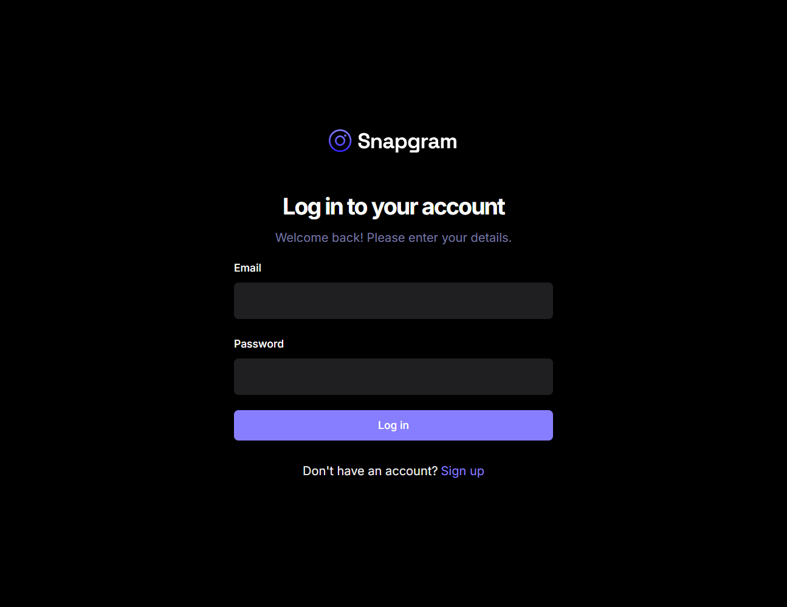
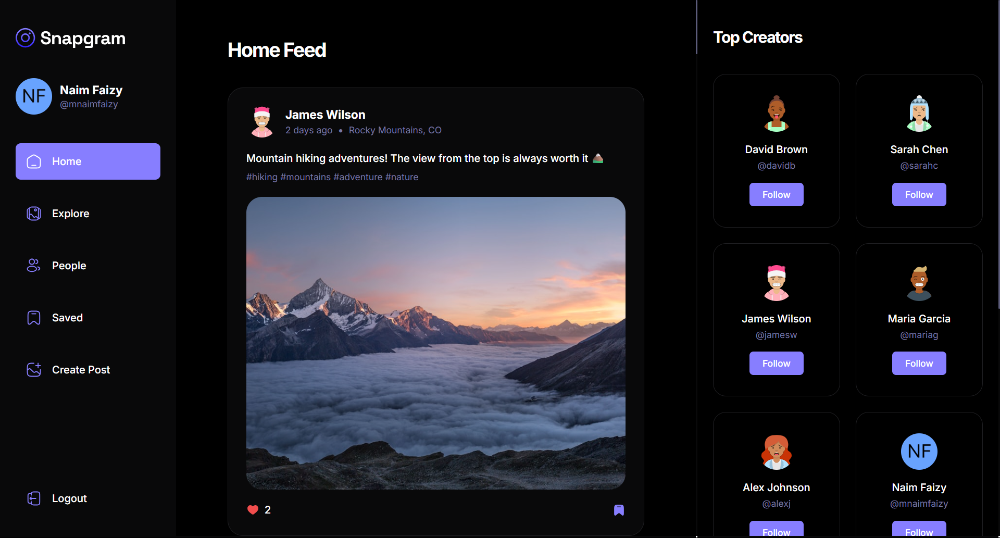
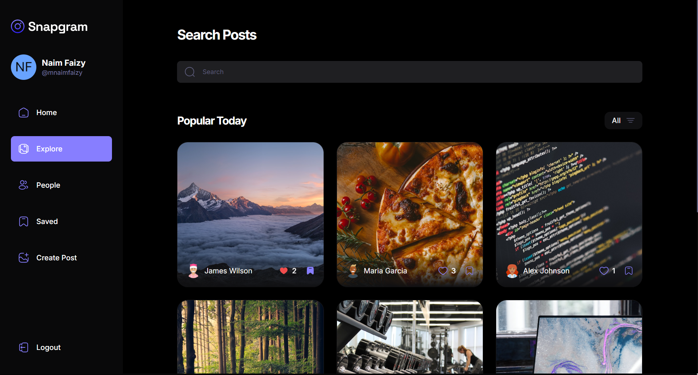
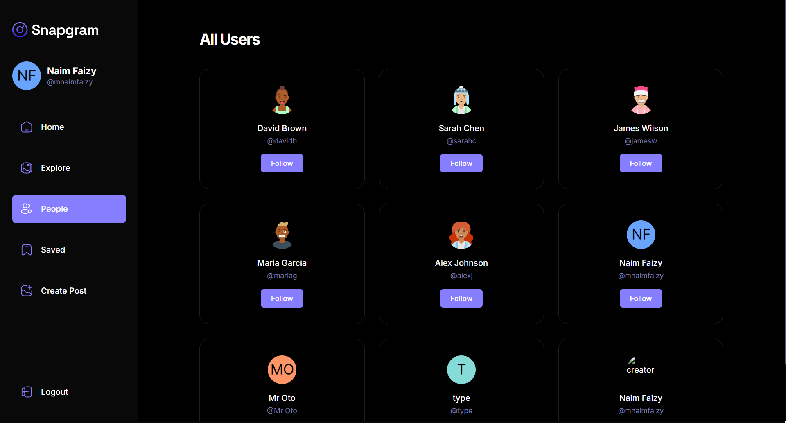
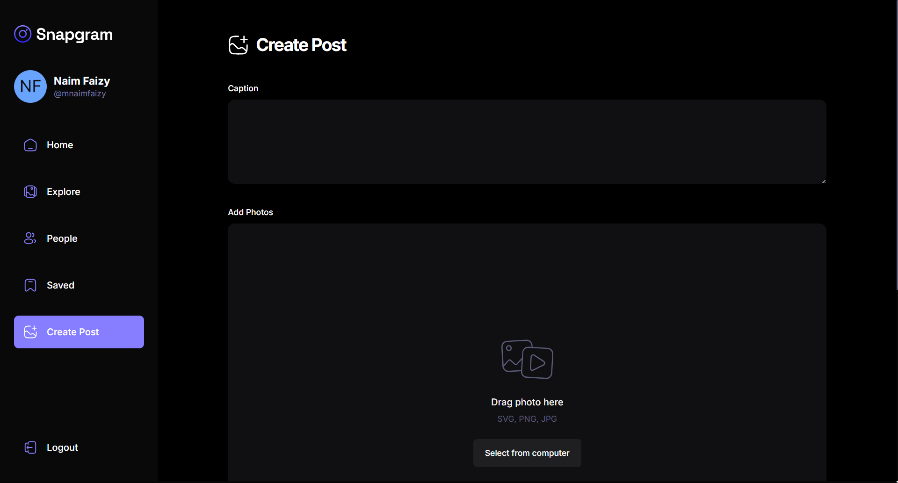

# Snapgram - Social Media Application

[](https://reactjs.org/)
[](https://www.typescriptlang.org/)
[](https://vitejs.dev/)
[](https://tailwindcss.com/)
[](https://appwrite.io/)
[](https://opensource.org/licenses/MIT)

A modern, full-featured social media application built with React, TypeScript, and Appwrite. Snapgram allows users to share posts, interact with content, explore feeds, and connect with other users in a responsive and intuitive interface.

## � Screenshots

### Login Page



### Home Feed



### Explore Page



### All Users



### Create Post



## �🚀 Features

- **User Authentication**
  - Sign up and sign in functionality
  - Secure authentication with Appwrite
  - Protected routes for authenticated users
  - Persistent user sessions

- **Post Management**
  - Create posts with images and captions
  - Edit and update existing posts
  - Delete posts
  - Add location and tags to posts
  - File upload with drag-and-drop support

- **Social Interactions**
  - Like and save posts
  - View liked posts collection
  - View saved posts collection
  - Explore feed with infinite scroll
  - Post details view with comments

- **User Features**
  - User profiles with bio and avatar
  - Update profile information
  - Upload custom profile pictures
  - View all users in the platform
  - User cards with follow functionality

- **Modern UI/UX**
  - Responsive design for mobile, tablet, and desktop
  - Dark theme interface
  - Smooth animations and transitions
  - Toast notifications for user feedback
  - Loading states and skeletons
  - Bottom navigation bar for mobile
  - Sidebar navigation for desktop

## 🛠️ Tech Stack

### Frontend

- **React 18.2** - UI library
- **TypeScript** - Type safety and better developer experience
- **Vite** - Fast build tool and development server
- **React Router DOM** - Client-side routing
- **Tailwind CSS** - Utility-first CSS framework
- **shadcn/ui** - Re-usable UI components built with Radix UI

### Backend & Services

- **Appwrite** - Backend as a Service (BaaS)
  - Authentication
  - Database
  - File Storage
  - Real-time capabilities

### State Management & Data Fetching

- **TanStack Query (React Query)** - Server state management and caching
- **React Context API** - Global authentication state

### Form Handling & Validation

- **React Hook Form** - Performant form management
- **Zod** - TypeScript-first schema validation

### UI Libraries

- **Radix UI** - Accessible component primitives
- **Lucide React** - Icon library
- **React Dropzone** - File upload component
- **React Intersection Observer** - Infinite scroll implementation

## 📁 Project Structure

```
src/
├── _auth/                  # Authentication layouts and forms
│   ├── AuthLayout.tsx     # Layout wrapper for auth pages
│   └── forms/
│       ├── SigninForm.tsx # Sign in form component
│       └── SignupForm.tsx # Sign up form component
│
├── _root/                  # Main application layouts and pages
│   ├── RootLayout.tsx     # Layout wrapper for authenticated pages
│   └── pages/             # Application pages
│       ├── Home.tsx       # Home feed
│       ├── Explore.tsx    # Explore posts
│       ├── Saved.tsx      # Saved posts
│       ├── CreatePost.tsx # Create new post
│       ├── EditPost.tsx   # Edit existing post
│       ├── PostDetails.tsx # Post detail view
│       ├── AllUsers.tsx   # All users list
│       ├── Profile.tsx    # User profile
│       ├── UpdateProfile.tsx # Update profile
│       └── LikedPosts.tsx # Liked posts collection
│
├── components/
│   ├── forms/
│   │   └── PostForm.tsx   # Reusable post form component
│   ├── shared/            # Shared/reusable components
│   │   ├── Topbar.tsx    # Top navigation bar
│   │   ├── LeftSidebar.tsx # Desktop sidebar
│   │   ├── Bottombar.tsx # Mobile bottom navigation
│   │   ├── PostCard.tsx  # Post card component
│   │   ├── PostStats.tsx # Post statistics (likes, saves)
│   │   ├── UserCard.tsx  # User card component
│   │   ├── GridPostList.tsx # Grid layout for posts
│   │   ├── FileUploader.tsx # File upload component
│   │   ├── ProfileUploader.tsx # Profile image uploader
│   │   └── Loader.tsx    # Loading spinner
│   └── ui/               # shadcn/ui components
│       ├── button.tsx
│       ├── form.tsx
│       ├── input.tsx
│       ├── label.tsx
│       ├── textarea.tsx
│       ├── toast.tsx
│       └── toaster.tsx
│
├── context/
│   └── AuthContext.tsx    # Authentication context provider
│
├── lib/
│   ├── appwrite/
│   │   ├── api.ts        # Appwrite API functions
│   │   └── config.ts     # Appwrite configuration
│   ├── react-query/
│   │   ├── queries.ts    # React Query hooks
│   │   ├── queryKeys.ts  # Query key constants
│   │   └── QueryProvider.tsx # Query client provider
│   ├── validation/
│   │   └── index.ts      # Zod validation schemas
│   └── utils.ts          # Utility functions
│
├── types/
│   └── index.ts          # TypeScript type definitions
│
├── hooks/
│   └── useDebounce.ts    # Custom debounce hook
│
├── constants/
│   └── index.ts          # Application constants
│
├── App.tsx               # Main application component
├── main.tsx              # Application entry point
└── globals.css           # Global styles
```

## 🔧 Installation

### Prerequisites

- Node.js (v16 or higher)
- npm or yarn package manager
- Appwrite account and project

### Steps

1. **Clone the repository**

   ```bash
   git clone <repository-url>
   cd react-social-media-app
   ```

2. **Install dependencies**

   ```bash
   npm install
   ```

3. **Set up Appwrite**
   - Create an account at [Appwrite](https://appwrite.io)
   - Create a new project
   - Set up the following:
     - Authentication (Email/Password provider)
     - Database with collections for:
       - Users
       - Posts
       - Saves
     - Storage bucket for media files

4. **Configure environment variables**

   Create a `.env.local` file in the root directory:

   ```env
   VITE_APPWRITE_URL=your_appwrite_endpoint
   VITE_APPWRITE_PROJECT_ID=your_project_id
   VITE_APPWRITE_DATABASE_ID=your_database_id
   VITE_APPWRITE_STORAGE_ID=your_storage_bucket_id
   VITE_APPWRITE_USER_COLLECTION_ID=your_user_collection_id
   VITE_APPWRITE_POST_COLLECTION_ID=your_post_collection_id
   VITE_APPWRITE_SAVES_COLLECTION_ID=your_saves_collection_id
   ```

5. **Run the development server**

   ```bash
   npm run dev
   ```

6. **Open your browser**

   Navigate to `http://localhost:5173`

## 📝 Scripts

- `npm run dev` - Start development server
- `npm run build` - Build for production
- `npm run preview` - Preview production build
- `npm run lint` - Run ESLint

## 🗄️ Database Schema

### Users Collection

- accountId (string)
- name (string)
- username (string)
- email (string)
- imageUrl (string)
- bio (string)

### Posts Collection

- creator (relationship to Users)
- caption (string)
- imageUrl (string)
- imageId (string)
- location (string)
- tags (array of strings)
- likes (array of user IDs)

### Saves Collection

- user (relationship to Users)
- post (relationship to Posts)

## 🎨 Styling

The project uses Tailwind CSS with a custom configuration for:

- Dark theme color palette
- Custom utility classes
- Responsive breakpoints
- Animations from tailwindcss-animate

## 🔐 Authentication Flow

1. User signs up with name, username, email, and password
2. Appwrite creates an account and generates avatar initials
3. User data is saved to the database
4. User can sign in with email and password
5. Authentication state is managed globally via Context API
6. Protected routes check authentication status
7. Users are redirected to sign-in if not authenticated

## 🚀 Key Features Implementation

### Infinite Scroll

Uses React Intersection Observer to detect when the user scrolls to the bottom and fetches more posts automatically.

### Image Upload

Drag-and-drop file upload with preview functionality using react-dropzone.

### Optimistic Updates

React Query handles optimistic updates for likes and saves, providing instant feedback to users.

### Form Validation

Zod schemas validate all forms before submission, ensuring data integrity.

### Responsive Design

Mobile-first approach with breakpoints for tablet and desktop views.

## 🎨 SEO & Branding

### Favicon

The project includes a custom SVG favicon located at `public/favicon.svg`. To generate PNG versions for better browser compatibility:

```bash
# Run the favicon generation script
chmod +x scripts/generate-favicons.sh
./scripts/generate-favicons.sh
```

Or use an online tool like [RealFaviconGenerator](https://realfavicongenerator.net/)

### SEO Optimization

The application is optimized for search engines with:

- **Meta Tags**: Comprehensive meta tags for search engines
- **Open Graph**: Social media sharing optimization (Facebook, LinkedIn)
- **Twitter Cards**: Twitter-specific meta tags
- **Structured Data**: JSON-LD schema for better search results
- **Sitemap**: XML sitemap at `/sitemap.xml`
- **Robots.txt**: Search engine crawling instructions
- **Semantic HTML**: Proper heading hierarchy and ARIA labels
- **Mobile-Friendly**: Responsive design with viewport meta tag
- **Performance**: Optimized images and lazy loading

### PWA Support

Progressive Web App manifest included at `public/site.webmanifest`:

- Installable on mobile devices
- Custom theme colors
- App icons for various platforms

## 🤝 Contributing

Contributions are welcome! Please feel free to submit a Pull Request.

## 📄 License

This project is open source and available under the MIT License.

## 🙏 Acknowledgments

- Built with [Vite](https://vitejs.dev/)
- UI components from [shadcn/ui](https://ui.shadcn.com/)
- Backend powered by [Appwrite](https://appwrite.io)
- Icons from [Lucide](https://lucide.dev/)

---

**Note:** Make sure to configure your Appwrite backend properly and set up all required collections and storage buckets before running the application.
